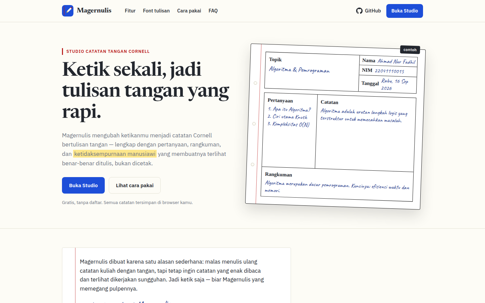
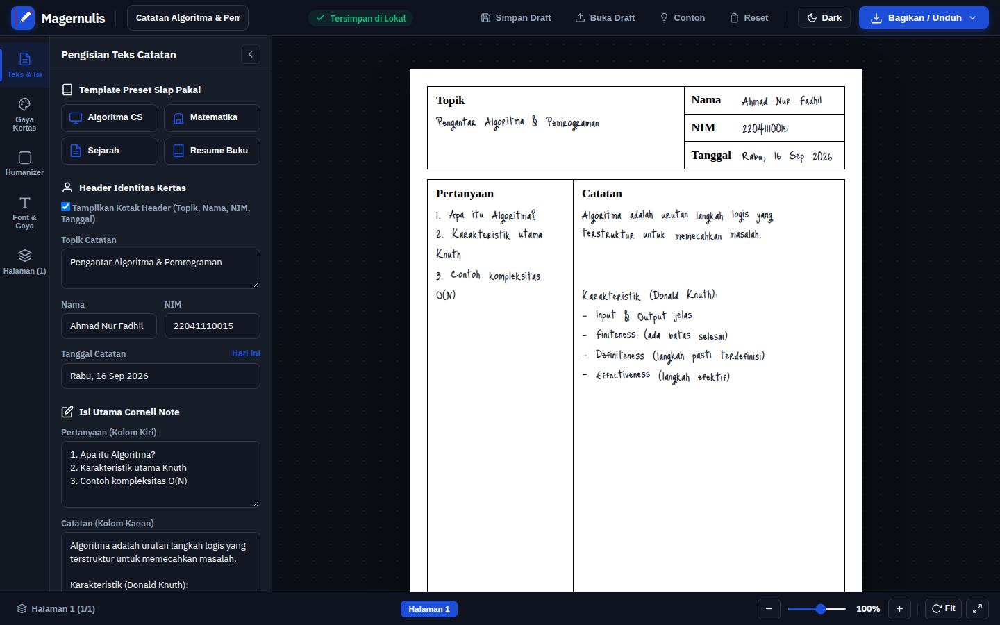

# Magernulis

**Ketik sekali, jadi tulisan tangan yang rapi.**

Magernulis mengubah ketikan menjadi catatan Cornell bertulisan tangan —
lengkap dengan pertanyaan, rangkuman, dan ketidaksempurnaan manusiawi yang
membuatnya terlihat benar-benar ditulis, bukan dicetak. Gratis, tanpa
daftar, semua tersimpan di browser.

🌐 **Live:** https://magernulis.pages.dev
📺 **Demo:** [docs/demo/demo.mp4](docs/demo/demo.mp4)


*Landing Magernulis — hero editorial dengan kartu kertas Cornell contoh.*


*Studio — panel isi, kertas Cornell, dan kanvas kerja.*

## Fitur

- **Catatan Cornell lengkap** — header identitas (topik, nama, NIM, tanggal),
  kolom pertanyaan, kolom catatan, dan rangkuman di bawah.
- **Mode Nulis (terpisah)** — tulisan tangan di atas kertas garis ala JNCK
  Nulis: form tanggal/nama/kelas/fakultas/teks, kertas Kertas 1–3 + HVS
  (dot grid), 12 font (4 dari JNCK + 9 Magernulis), halaman otomatis
  mengikuti panjang teks, ekspor PNG/ZIP/PDF. Buka di
  `studio/nulis.html`. Kertas Buku 1–8 (foto buku asli) dan 30 font JNCK
  lainnya belum masuk — butuh foto/sumber sendiri dan cek lisensi.
- **Humanizer** — mengacak sudut miring dan posisi tiap kata seperti tulisan
  tangan manusia; 4 tingkat (Rapi, Halus, Natural, Acak) + tombol gacha.
- **9 font tulisan tangan** — semuanya gaya acak natural (Caveat, Gochi Hand,
  dsb.), lengkap dengan ukuran font dan jarak baris yang bisa diatur.
- **4 kertas, 4 tinta, 5 efek scan, 3 backdrop meja** — Folio Bergaris,
  Grid Binder, Vintage Cream, HVS Putih; efek Clean, Shadow, Warm,
  Photocopy, dan tanpa filter.
- **Multi-halaman** — tambah/hapus lembar; halaman lanjutan otomatis tanpa
  header, seperti lampiran catatan asli.
- **Ekspor lengkap** — lewat panel **Bagikan** (kanan atas, ala Canva):
  PNG/JPG halaman ini, ZIP semua halaman, PDF HD (satu / semua halaman),
  cetak langsung, salin gambar ke clipboard; preset Digital / Cetak.
- **Undo/Redo** di topbar; autosave "Semua perubahan disimpan".
- **Draft .json** — simpan pekerjaan dan buka lagi kapan saja; contoh
  catatan dan 4 template preset siap pakai.
- **Tema gelap/terang**, zoom 30–150%, mode layar penuh.

## Cara jalan

Tidak ada build step dan tidak ada dependensi produksi. Cukup sajikan
folder repo sebagai situs statis:

```bash
# Paling cepat — server statis bawaan repo
npm run serve
# lalu buka http://127.0.0.1:8331/

# atau server apa pun, misal:
python3 -m http.server 8331
```

Buka `http://127.0.0.1:8331/` untuk landing, lalu klik **Buka Studio**
atau langsung ke `/studio/`.

> Catatan: font tulisan tangan (Google Fonts) dan pustaka ekspor
> (html2canvas, jsPDF, JSZip) dimuat dari CDN saat pertama dibuka — butuh
> internet di kunjungan pertama. Aplikasi dan catatanmu sendiri tidak
> pernah dikirim ke server mana pun.

## Struktur proyek

```
index.html                  landing page
css/landing.css             gaya landing
studio/
  index.html                aplikasi studio
  css/style.css             gaya studio
  js/index.js               engine studio (humanizer, halaman, ekspor)
  assets/logo.svg           logo datar Magernulis
docs/
  DESIGN.md                 kontrak arah desain + referensi + gate 7 sumbu
  ARCHITECTURE.md           arsitektur & alur data
  USER-GUIDE.md             panduan pengguna
  diagrams.html             diagram arsitektur & alur (HTML+SVG)
  deploy.md                 cara deploy ke Cloudflare Pages
  referensi/CornellNote.pdf template kertas Cornell acuan (2 halaman)
  screenshots/              screenshot desktop + mobile
  demo/demo.mp4             video demo (dari screenshot)
e2e/app.spec.js             Playwright e2e (landing + studio)
scripts/
  serve.mjs                 server statis lokal
  check-links.mjs           validasi tautan lokal
  check-static.mjs          gate anti-slop P0 + secret-scan
  advisory-sweep.py         sweep OSV (produksi saja)
  screenshot.mjs            ambil screenshot dokumentasi
  smoke.mjs                 smoke test folder repo
```

## Pengembangan

```bash
npm ci            # pasang devDependencies (Playwright + puppeteer-core)
npm run validate  # tautan + gate P0 + secret-scan
npm test          # Playwright e2e (desktop + mobile)
npm run smoke     # smoke test folder repo
npm run screenshots   # ambil ulang docs/screenshots/*.png
npm run make-video    # rangkai screenshot desktop jadi docs/demo/demo.mp4
npm run sweep     # OSV sweep dependensi produksi
```

CI (`.github/workflows/ci.yml`, Node 24): `static-checks`,
`advisory-sweep`, `playwright-e2e`, `smoke`.

## Dokumentasi

- [PRD](PRD.md) — kebutuhan produk
- [docs/DESIGN.md](docs/DESIGN.md) — kontrak desain (referensi: Ebb, Framer)
- [docs/ARCHITECTURE.md](docs/ARCHITECTURE.md) — arsitektur
- [docs/USER-GUIDE.md](docs/USER-GUIDE.md) — panduan pengguna
- [docs/diagrams.html](docs/diagrams.html) — diagram
- [CHANGELOG.md](CHANGELOG.md) — riwayat perubahan

## Lisensi

MIT — lihat [LICENSE](LICENSE). Dibuat oleh
[Nabil Aulia Dika](https://github.com/dezzorigin) (dezzorigin).
